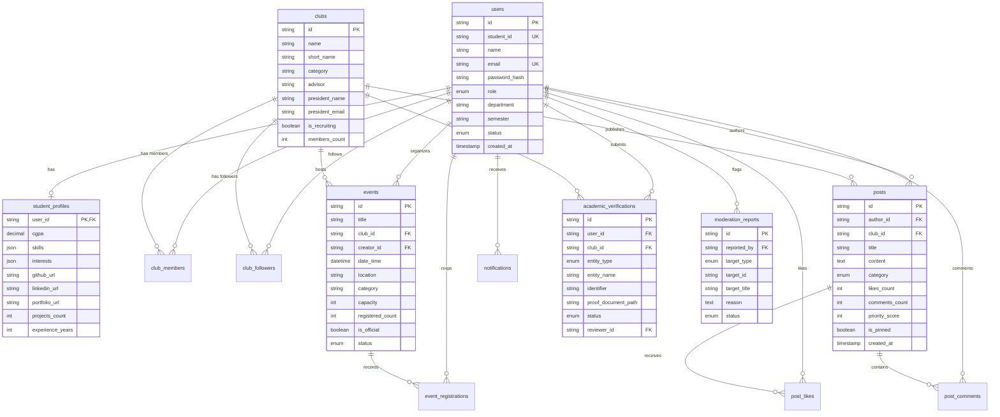

# EDUConnect Database Architecture & Relational Schema Documentation

**Course:** CSE 242: Web Development (Fall 2026)  
**Institution:** East Delta University (EDU), School of Science, Engineering & Technology (SoSET)  
**Instructor:** Asst. Prof. Saraf Anika, Dept. of Computer Science & Engineering  
**Project Team:**
- **Raida Salsabil Sarwar** (Student ID: `243011912`)
- **Pritam Barua** (Student ID: `243007712`)
- **Fardin Tajwar Chowdhury** (Student ID: `243009912`)
- **Md. Omar Mahabub** (Student ID: `243007512`)
- **Anika Thashen Autshe** (Student ID: `243015112`)

---

## 1. Executive Summary & Relational Design

EDUConnect is engineered with a fully normalized (3NF) relational database schema using **MySQL 8.0+** (`InnoDB` storage engine with `utf8mb4` character encoding). The architecture supports university-wide identity verification, student profiles with skill matching, club charters, event lifecycles, an algorithmic newsfeed, community moderation, and real-time notifications.

### Key Architectural Strengths:
1. **Referential Integrity & Cascading Constraints:** Foreign keys are explicitly defined across all relationships with appropriate `ON DELETE CASCADE` or `ON DELETE SET NULL` rules.
2. **Performance Indexing:** Targeted composite and single-column indexes on high-throughput columns (`email`, `student_id`, `role`, `status`, `date_time`, `priority_score`, `created_at`).
3. **Structured JSON Attributes:** Hybrid approach leveraging MySQL native `JSON` columns for extensible dynamic attributes (`skills` and `interests` lists) while keeping core relational attributes strictly typed.
4. **Data Isolation:** Complete separation between authentication credentials, academic portfolio metadata, and moderation queues.

---

## 2. Entity-Relationship (ER) Diagram



---

## 3. Comprehensive Table Catalog

### 3.1. `users` (Core Identity & Authentication)
Stores core system accounts for students, club representatives, and faculty administrators.

| Column | Data Type | Constraints | Description |
| :--- | :--- | :--- | :--- |
| `id` | `VARCHAR(36)` | `PRIMARY KEY` | Unique UUID or system identifier |
| `student_id` | `VARCHAR(30)` | `UNIQUE`, `NOT NULL` | University Student ID (e.g. `243011912`) or Faculty ID |
| `name` | `VARCHAR(150)` | `NOT NULL` | Full legal name of student or faculty member |
| `email` | `VARCHAR(150)` | `UNIQUE`, `NOT NULL` | Official academic email (`*.edu` or `*.ac.bd`) |
| `password_hash` | `VARCHAR(255)` | `NOT NULL` | Secure password hash or credential string |
| `role` | `ENUM` | `student`, `club_rep`, `admin` | Role-based access level |
| `department` | `VARCHAR(150)` | `NOT NULL` | Academic department (e.g. `Computer Science & Engineering`) |
| `semester` | `VARCHAR(50)` | Default `'6th Semester'` | Current semester level |
| `avatar_url` | `TEXT` | Nullable | Profile portrait avatar URL |
| `bio` | `TEXT` | Nullable | Short professional academic biography |
| `status` | `ENUM` | `Verified`, `Pending Verification`, `Verification Rejected` | Academic verification status |
| `created_at` | `TIMESTAMP` | `DEFAULT CURRENT_TIMESTAMP` | Account registration timestamp |
| `updated_at` | `TIMESTAMP` | `ON UPDATE CURRENT_TIMESTAMP` | Record modification timestamp |

*Indexes:* `idx_users_email`, `idx_users_student_id`, `idx_users_role`, `idx_users_status`.

---

### 3.2. `student_profiles` (Skills, Interests & Portfolios)
Stores normalized student profile attributes used by the recommendation matching algorithm.

| Column | Data Type | Constraints | Description |
| :--- | :--- | :--- | :--- |
| `user_id` | `VARCHAR(36)` | `PRIMARY KEY`, `FK -> users(id)` | Cascading reference to user record |
| `cgpa` | `DECIMAL(3,2)` | `DEFAULT 3.80` | Current academic grade point average |
| `skills` | `JSON` | `NOT NULL` | JSON array of technical competencies (`["React", "Node.js", "MySQL"]`) |
| `interests` | `JSON` | `NOT NULL` | JSON array of research & career interests |
| `github_url` | `VARCHAR(255)` | Nullable | GitHub developer profile URL |
| `linkedin_url` | `VARCHAR(255)` | Nullable | LinkedIn professional profile URL |
| `portfolio_url`| `VARCHAR(255)` | Nullable | Personal portfolio website |
| `projects_count`| `INT` | Default `0` | Number of verified portfolio projects |
| `experience_years`| `INT` | Default `1` | Technical experience tier in years |

---

### 3.3. `clubs` (Student Clubs & Organizations)
Chartered student clubs registered under the East Delta University Student Affairs Council.

| Column | Data Type | Constraints | Description |
| :--- | :--- | :--- | :--- |
| `id` | `VARCHAR(36)` | `PRIMARY KEY` | Unique club identifier (e.g. `club_01`) |
| `name` | `VARCHAR(150)` | `NOT NULL` | Full club title (e.g. `EDU Computer Club`) |
| `short_name` | `VARCHAR(50)` | `NOT NULL` | Acronym (e.g. `EDUCC`, `EDURC`) |
| `category` | `VARCHAR(100)` | `NOT NULL` | Academic, Robotics, Cultural, Business, Debate |
| `tagline` | `VARCHAR(255)` | `NOT NULL` | Club mission motto |
| `description` | `TEXT` | `NOT NULL` | Comprehensive club charter description |
| `advisor` | `VARCHAR(150)` | `NOT NULL` | Faculty advisor name & academic title |
| `president_name`| `VARCHAR(150)` | `NOT NULL` | Student president executive lead |
| `president_email`| `VARCHAR(150)` | `NOT NULL` | Official contact email |
| `logo_url` | `TEXT` | `NOT NULL` | High-resolution club emblem |
| `cover_url` | `TEXT` | `NOT NULL` | Club banner header image |
| `is_recruiting` | `BOOLEAN` | Default `FALSE` | Active executive recruitment toggle |
| `members_count` | `INT` | Default `0` | Total registered membership count |

*Indexes:* `idx_clubs_category`, `idx_clubs_recruiting`.

---

### 3.4. `events` (Campus Events & Workshops)
Event schedule and RSVP management.

| Column | Data Type | Constraints | Description |
| :--- | :--- | :--- | :--- |
| `id` | `VARCHAR(36)` | `PRIMARY KEY` | Event identifier (e.g. `evt_01`) |
| `title` | `VARCHAR(200)` | `NOT NULL` | Event headline |
| `club_id` | `VARCHAR(36)` | `FK -> clubs(id)` (`ON DELETE SET NULL`) | Host club organizer (nullable if university-wide) |
| `creator_id` | `VARCHAR(36)` | `FK -> users(id)` (`ON DELETE CASCADE`) | Faculty or student organizer who created event |
| `date_time` | `DATETIME` | `NOT NULL` | Scheduled date and start time |
| `location` | `VARCHAR(200)` | `NOT NULL` | Campus room, hall, or auditorium |
| `category` | `VARCHAR(100)` | `NOT NULL` | Hackathon, Workshop, Defense, Competition |
| `description` | `TEXT` | `NOT NULL` | Detailed itinerary and prerequisites |
| `image_url` | `TEXT` | `NOT NULL` | Promotional event banner |
| `capacity` | `INT` | Default `100` | Maximum attendee registration limit |
| `registered_count` | `INT` | Default `0` | Active RSVP counter |
| `is_official` | `BOOLEAN` | Default `TRUE` | Verified university sanction |
| `status` | `ENUM` | `upcoming`, `ongoing`, `completed`, `cancelled` | Current event lifecycle state |

*Indexes:* `idx_events_club`, `idx_events_datetime`, `idx_events_status`.

---

### 3.5. `posts` (Algorithmic Campus Newsfeed)
Feed posts supporting the 2-section algorithmic recommendation system.

| Column | Data Type | Constraints | Description |
| :--- | :--- | :--- | :--- |
| `id` | `VARCHAR(36)` | `PRIMARY KEY` | Post identifier (e.g. `post_01`) |
| `author_id` | `VARCHAR(36)` | `FK -> users(id)` (`ON DELETE CASCADE`) | Student or faculty author |
| `club_id` | `VARCHAR(36)` | `FK -> clubs(id)` (`ON DELETE SET NULL`) | Associated club (if announcement) |
| `title` | `VARCHAR(255)` | Nullable | Announcement headline |
| `content` | `TEXT` | `NOT NULL` | Main post copy |
| `category` | `ENUM` | `announcement`, `event_recap`, `project_showcase`, `discussion`, `academic` | Category classification |
| `media_url` | `TEXT` | Nullable | Attached photo or flyer |
| `likes_count` | `INT` | Default `0` | Aggregate positive endorsements |
| `comments_count`| `INT` | Default `0` | Aggregate comments |
| `priority_score`| `INT` | Default `0` | Computed feed weight based on follows, events, and urgency |
| `is_pinned` | `BOOLEAN` | Default `FALSE` | Faculty-pinned priority banner |

*Indexes:* `idx_posts_author`, `idx_posts_club`, `idx_posts_priority`, `idx_posts_created`.

---

### 3.6. Verification & Moderation Tables
- **`academic_verifications`:** Tracks student admission documents (`Official_Admission_Verification.pdf`, student ID scans) and club charters awaiting faculty admin review.
- **`moderation_reports`:** Safe campus moderation queue enabling students to flag policy violations with administrative resolution actions (`Resolved`, `Content Removed`, `Dismissed`).

---

## 4. Default Seed Accounts (Real University Data)

| User ID | Role | Name | Official Email | Default Credential | Student / Faculty ID |
| :--- | :--- | :--- | :--- | :--- | :--- |
| `admin_01` | **Faculty Admin** | Asst. Prof. Saraf Anika | `saraf.anika@faculty.edu` | `admin123` | `FACULTY-CSE-242` |
| `std_01` | **Student Lead** | Raida Salsabil Sarwar | `raida.sarwar@student.edu` | `student123` | `243011912` |
| `std_02` | **Student Lead** | Pritam Barua | `pritam.barua@student.edu` | `student123` | `243007712` |
| `std_03` | **Student Lead** | Fardin Tajwar Chowdhury | `fardin.tajwar@student.edu` | `student123` | `243009912` |
| `std_04` | **Student Lead** | Md. Omar Mahabub | `omar.mahabub@student.edu` | `student123` | `243007512` |
| `std_05` | **Student Lead** | Anika Thashen Autshe | `anika.thashen@student.edu` | `student123` | `243015112` |

---

## 5. How to Import and Setup

### Method 1: Using MySQL Terminal / Command-Line Interface
```bash
# Connect to your MySQL server and execute schema.sql
mysql -u root -p < database/schema.sql

# Or directly from the project root:
mysql -u root -p < schema.sql
```

### Method 2: Using phpMyAdmin (XAMPP / WAMP / LAMP)
1. Open your web browser and navigate to `http://localhost/phpmyadmin`.
2. Click on the **Import** tab in the top navigation bar.
3. Click **Browse your computer...** and select `schema.sql` (located in the project root or `/database/schema.sql`).
4. Keep character set as `utf-8` and SQL format.
5. Click **Import** at the bottom of the page. The database `edu_connect` and all 13 tables will be created and populated automatically.

### Method 3: Using MySQL Workbench
1. Launch **MySQL Workbench** and open your active Local Instance connection.
2. Go to **File -> Open SQL Script...** and select `database/schema.sql`.
3. Click the lightning bolt icon (**Execute**) to run the entire script.
4. Refresh the **Schemas** navigator on the left panel to inspect the populated `edu_connect` schema.

---

## 6. Verification Queries

Once imported, you can run the following SQL queries to verify table creation and data seeding:

```sql
-- 1. Check all populated tables
USE edu_connect;
SHOW TABLES;

-- 2. Verify all real students and faculty admin
SELECT id, student_id, name, email, role, department, status FROM users;

-- 3. Verify real East Delta University clubs
SELECT short_name, name, category, advisor, members_count, is_recruiting FROM clubs;

-- 4. Verify scheduled events including the CSE 242 Final Defense
SELECT title, date_time, location, capacity, registered_count, is_official FROM events;

-- 5. Test algorithmic feed sorting
SELECT p.id, p.title, u.name AS author, p.category, p.priority_score, p.likes_count, p.created_at
FROM posts p
JOIN users u ON p.author_id = u.id
ORDER BY p.priority_score DESC, p.created_at DESC;
```
